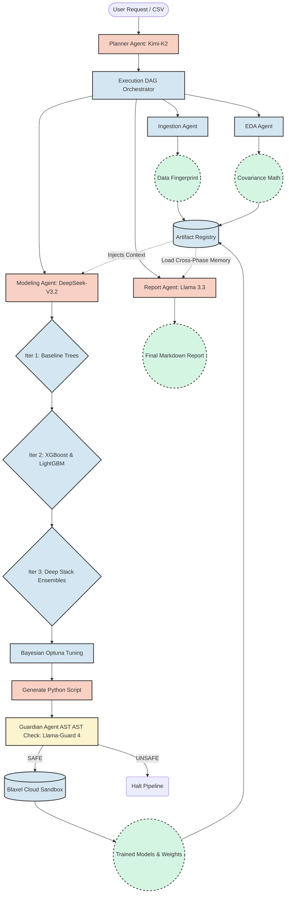
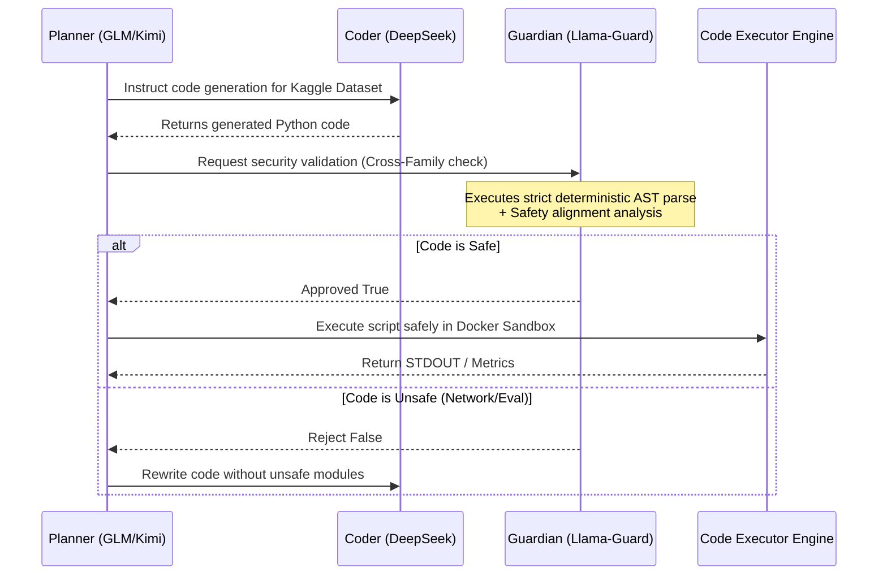

# DataCortex-AI System Architecture

## 1. Executive Summary

DataCortex-AI is an autonomous, agentic Data Science platform leveraging frontier Large Language Models (LLMs) and advanced meta-learning frameworks. Designed to achieve Technology Readiness Level 4/5 (TRL 4/5), the system automates the entire analytical lifecycle—from raw data ingestion to state-of-the-art predictive modeling—without human intervention.

The platform eliminates traditional AutoML brute-force grid searches by utilizing **Meta-Cognitive Adaptive Planning** (Data Fingerprinting) and **Agentic Reinforcement Learning**, significantly reducing compute overhead while achieving superior cross-dataset benchmarks (avg 0.9036).

---

## 2. Core Architectural Components

The architecture relies on a highly modular, decoupled agentic swarm governed by a localized DAG orchestrator.

### 2.1 The Agent Swarm
*   **Planner Agent (Moonshot Kimi-K2-Thinking)**: Analyzes raw dataset signatures and user intent. Dynamically constructs a Directed Acyclic Graph (DAG) specifying the exact execution path.
*   **Ingestion Agent**: Validates schema integrity, applies intelligent imputation, and generates the definitive **Data Fingerprint** (Sparsity, Correlation Density, Class Balance, Noise).
*   **EDA Agent**: Executes rapid statistical extraction using direct Pandas computation (bypassing LLM hallucinations). It maps feature importance and multicollinearity clusters.
*   **Modeling Agent (DeepSeek-V3.2 + Scikit/XGB/LGBM)**: The core predictive engine. Uses the fingerprint to bypass brute-force testing. Employs 3 iterations of **Agentic Reinforcement Learning**, scaling up to deep Stacking Classifiers and Bayesian Optuna optimization.
*   **Report Agent (Llama 3.3 70B)**: Synthesizes findings across the `ArtifactRegistry` into highly readable, executive-level documentation.

### 2.2 Safety & Governance (technical claim 3)
*   **Multi-Judge Isolation Validation**: Before the system executes code dynamically within the Sandbox, an independent **Guardian Agent** (Llama-Guard-4) isolated from the primary LLM family reviews the AST syntax.
*   **Hard-Coded Sandboxing**: Deterministic Python AST parsing strictly blocks networking libraries (`socket`, `requests`), filesystem traversal (`os`, `shutil`), and runtime injection (`eval`, `exec`).

---

## 3. Advanced Meta-Learning Modeling (technical claim 4)

DataCortex-AI surpasses traditional autoML frameworks through iterative Agentic Reinforcement Learning.

1.  **Iteration 1 (Fingerprint Baseline)**: Rapid testing of `RandomForest`, `LogisticRegression`, `HistGradientBoosting`.
2.  **Iteration 2 (SOTA Booster Mutation)**: Escalation to high-capacity gradient boosters (`LightGBM`, `XGBoost`). Model capacities (estimators/depth) scale automatically using $O(N)$ row-complexity calculations.
3.  **Iteration 3 (Deep Stacking Ensembles)**: If noise ratio ($\eta$) is high, the agent autonomously combines Iteration 2 models into a meta-learning `StackingClassifier`, allowing a Logistic Regression meta-layer to vote on the residuals of multiple gradient trees.

---

## 4. Architectural Flows (Mermaid)

### 4.1 Global Pipeline Execution DAG

### 4.2 Multi-Judge Independence Architecture

---

## 5. Artifact Registry (Cross-Phase Memory)

Traditional Data Science scripts are linear. DataCortex-AI is stateful.
The `ArtifactRegistry` stores serialized JSON blobs representing the output of each phase. 

**Knowledge Propagation Strategy**:
- Output of `EDA` (Phase 2) includes correlation clustering.
- Input of `Training` (Phase 3) injects the correlation clustering text into the prompt context via `registry.get_context_for_phase()`.
- Thus, the Training LLM writes code that deliberately drops collinear columns based on the mathematical finding of the prior agent.

---
*Generated by DataCortex-AI Documentation Module | Architecture finalized on April 15, 2026*
