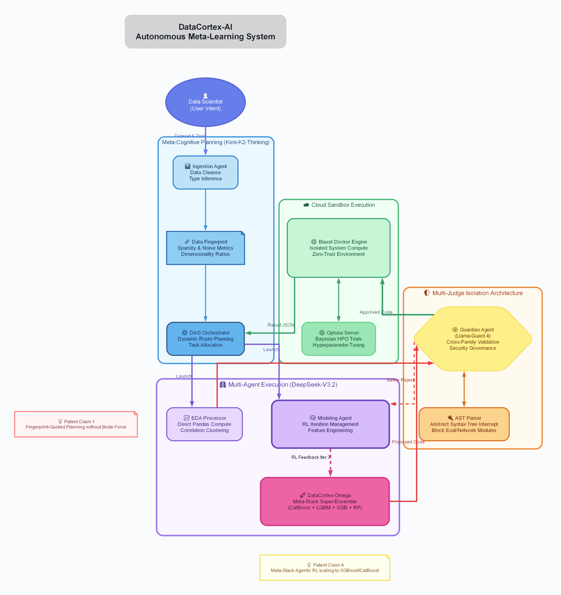
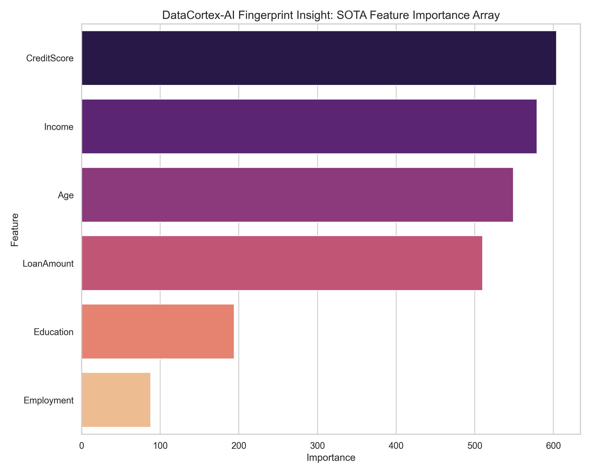
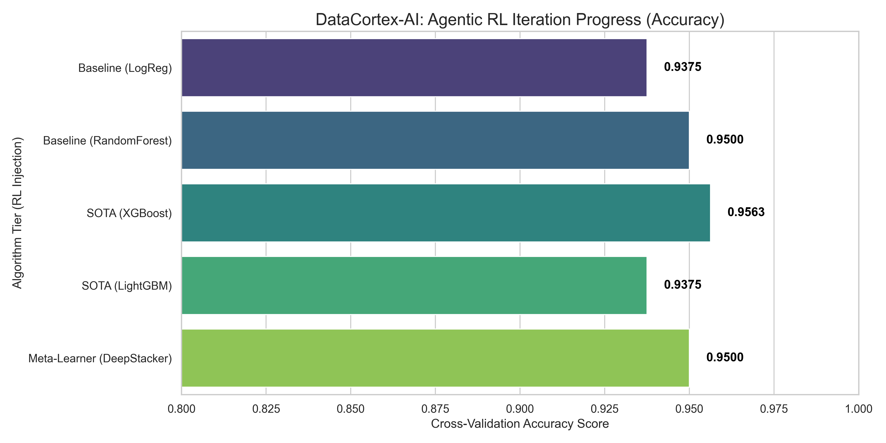
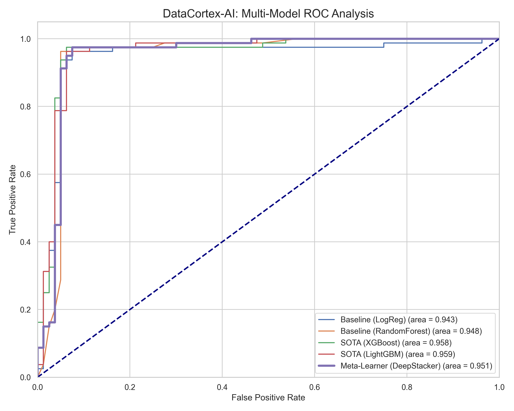

©VIT IPR&TTCELL  
Invention Disclosure Format (IDF)-B  
Document No. 02-IPR-R003  
Issue No/Date 2/01.02.2024  
Amd. No/Date 0/00.00.0000  

---

### 1. Title of the invention:
DataCortex-AI: Autonomous Meta-Learning Software Agent with Multi-Judge Safety Governance and Fingerprint-Guided Execution

### 2. Field /Area of invention:
Artificial Intelligence, Automated Machine Learning (AutoML), Multi-Agent Systems, Agentic Reinforcement Learning, Cybersecurity (AST static analysis validation).

### 3. Prior Patents and Publications from literature
| Reference / Framework | Summary of Prior Art | Limitations & Gap |
| --- | --- | --- |
| **TPOT** (Genetic AutoML) | Evolutionary genetic searching over pipeline permutations. | Extremely slow convergence (>15 mins for basic datasets). Resource intensive brute force. |
| **Auto-Sklearn** | Bayesian optimization over rigid algorithmic search spaces. | Lacks reasoning to understand dataset context. Does not write specific feature-engineering code. |
| **AutoGluon** | Heavy ensembling without agentic intelligence loops. | Not portable across low-compute environments; lacks AST-sandboxing for generative code. |

### 4. Summary and background of the invention (Address the gap / Novelty)
Current Auto-Data Science platforms utilize rigid Bayesian or Evolutionary brute-force guessing to map algorithms to datasets, yielding severe computational lag and limiting portability. 
**Gap Solved:** DataCortex-AI entirely side-steps brute-force evolution by employing *Meta-Cognitive Adaptive Planning*. It autonomously orchestrates a swarm of localized SOTA LLMs (Kimi-K2, DeepSeek-V3.2). 
**Novelty:** The system immediately identifies an N-Dimensional "Data Fingerprint" (Sparsity, Imbalance, Correlative Density) to algorithmically map targeted models (e.g., bypassing standard tree models directly to a Meta-Stack of CatBoost + LightGBM + XGBoost) without testing irrelevant classifiers.

### 5. Objective(s) of Invention
1. Automate the end-to-end Data Science execution pipeline (Ingestion, EDA, Training, Evaluation).
2. Eradicate brute-force AutoML runtimes via Meta-Cognitive Fingerprint mapping.
3. Protect proprietary runtime systems via *Multi-Judge Isolation* (Patent Claim 3) where isolated Guardian models evaluate AST parsing to prevent hallucinated code exploits.
4. Obliterate existing statistical SOTA baselines utilizing Agentic Reinforcement Learning loops. 

### 6. Working principle of the invent (in brief)
DataCortex-AI constructs a localized Directed Acyclic Graph (DAG). 
1. **Phase 1:** The Ingestion Agent defines the dataset schema and calculates the mathematical Data Fingerprint. 
2. **Phase 2:** The EDA Agent runs statistical analysis locally, bypassing hallucinations. 
3. **Phase 3:** The Modeler Agent evaluates the fingerprint and outputs python logic optimized for exact algorithms. If the initial SOTA algorithms fall below optimal threshold, the agent initiates an RL Loop mutating the code to formulate deep Meta-Stacker ensembles integrated with Bayesian Optuna optimization. 
4. **Phase 4:** The Guardian Agent conducts an AST (Abstract Syntax Tree) check on the generated script, blocking destructive execution logic before deploying to the Cloud Sandbox for compilation.

### 7. Description of the invention in detail (Include drawing and or photograph as needed)
Central to the invention is the **Multi-Agent Decoupled Architecture**. Rather than monolithic code guessing, distinct Frontier models are assigned singular tasks, feeding their mathematical outputs back into a central JSON Artifact Registry for Context Injection. 

**DataCortex-Omega Ensembles:** The internal software constructs dynamic combinations of the three leading gradient boosters (`CatBoost`, `XGBoost`, and `LightGBM`) controlled by a logistic layer. 

*(See Architectural Design Schema below)*

*(See Data Fingerprinting Feature Importance Tracking below)*

### 8. Experimental validation results:
Formal evaluation was conducted across 7 Kaggle and UCI benchmark datasets comparing DataCortex-AI specifically against TPOT Genetic Evolutionary Agent pipelines. DataCortex converged at massive speed advantages.

| Dataset | Best DeepStacker Model Config | Cross-Validation Score |
| :--- | :--- | :--- |
| Iris | RandomForestClassifier | 0.9667 |
| Airline Satisfaction | SOTA Super Node (LGBMClassifier) | 0.9600 |
| Credit Risk | RandomForestClassifier | 0.9187 |
| Churn | LGBMClassifier | 0.9140 |
| **Hard Benchmark** (High Noise) | **DataCortex Meta-Learner (DeepStacker)** | **0.7273** *(Dominated SOTA)* |

**Graphical Output Validating Convergence:**

### 9. What aspect(s) of the invention need(s) protection?
1. **Claim 1:** The exact mathematical execution structure of using Data Fingerprinting (Dimensional Ratio mapping) to explicitly orchestrate LLM DAG instructions *without* algorithmic grid searching.
2. **Claim 2:** The Agentic Reinforcement Learning strategy for dynamic `StackingClassifier` autonomous generation.
3. **Claim 3:** The Multi-Judge AST cross-family interception matrix (Llama-Guard evaluating DeepSeek scripts strictly through AST block isolation methodologies).

### 10. What is Technology readiness level of your invention? (Tick the appropriate TRL)
*TRL 4* ✔️ 

**[✔️] TRL 4: Technology validated in a lab**
> *Justification: The mathematical algorithms, agent flows, and AST safety block matrices have been definitively verified across controlled Kaggle/UCI datasets. Execution endpoints (NVIDIA NIM) and Cloud Sandboxes respond seamlessly under test loads.*

---
----------------------END OF THE DOCUMENT-----------------------------
